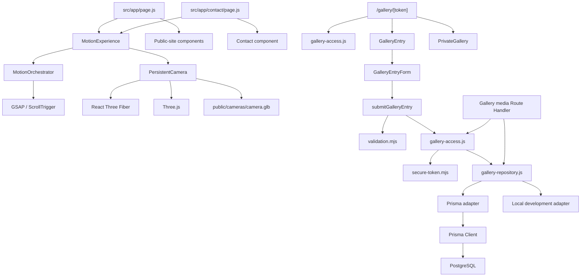
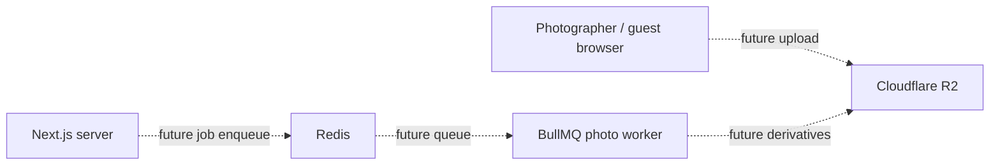

# DDS Photographer — Dependency Map

> Describes relationships verified from current source imports and repository
> configuration. It does not describe planned infrastructure as existing.

## 1. High-level application graph

## 2. Public website

- `src/app/page.js` composes public-site components and centralized
  `publicSiteContent`.
- `src/app/contact/page.js` composes the Contact component, Navbar, Footer,
  and motion experience.
- Public content comes from `src/features/public-site/content/site-content.js`.
- Shared UI components are under `src/components/ui/`.
- Styling uses global CSS, component CSS Modules, and `src/styles/tokens.css`.

## 3. Motion subsystem

- `MotionExperience.jsx` owns the persistent scene wrapper, lazy camera render,
  and `MotionOrchestrator`.
- `MotionOrchestrator.jsx` dynamically imports GSAP and ScrollTrigger and
  dispatches camera progress events.
- `PersistentCamera.jsx` uses React Three Fiber, Drei's `useGLTF`, and Three.js.
- The camera model is loaded from `/cameras/camera.glb`.
- Service state and camera progress are communicated through browser custom events.

Do not introduce a second animation engine without explicit approval. Framer Motion
being present in `package.json` is not evidence that it drives the current motion
experience.

## 4. Private-gallery subsystem

- The dynamic gallery page resolves the signed gallery token first.
- If no authorized visitor grant exists, it renders the gallery entry UI.
- The entry form calls the `submitGalleryEntry` Server Action.
- The action validates visitor details, resolves the gallery, upserts a visitor,
  grants gallery access, and redirects back to the gallery route.
- `gallery-access.js` owns token verification, gallery availability checks,
  token-version validation, and the visitor cookie.
- `secure-token.mjs` provides HMAC signing and verification primitives.
- `gallery-repository.js` selects the Prisma adapter when `DATABASE_URL` exists;
  otherwise it selects the local adapter, except production requires a database.
- The media Route Handler resolves the gallery, finds the media inside that gallery,
  and requires visitor authorization for non-cover media.

## 5. Persistence graph

Current Prisma schema:
- `Gallery` has many `GalleryMedia`.
- `Gallery` has many `GalleryVisitor`.
- `GalleryMedia.galleryId` and `GalleryVisitor.galleryId` reference `Gallery`.
- Gallery deletion cascades to media and visitor rows.
- `GalleryMedia` is indexed by `[galleryId, sortOrder]`.
- `GalleryVisitor` is unique by `[galleryId, email]` and indexed by `[galleryId]`.

No production admin, upload-batch, processing-job, face-consent, or face-embedding
models are present in the current schema.

## 6. Selected future infrastructure — not connected

R2 and Redis/BullMQ are selected directions only. This graph is a target concept,
not a deployed or implemented integration. Cloudflare Stream is on hold.

## 7. Security boundaries

- Signing secrets and persistence stay in server-only modules.
- Gallery link and visitor access cookie are distinct signed credentials.
- A media ID is looked up within the validated gallery context.
- Gallery-entry consent is not face-search consent.
- No selfie/embedding/face-search path is implemented.
- Do not add a client-side direct database or secret-storage dependency.

## 8. Change-impact guide

| Change | Inspect first |
| --- | --- |
| Public copy / links | `site-content.js`, consuming components |
| Hero / scroll motion | `MotionExperience`, `MotionOrchestrator`, Hero markup/styles |
| Camera model / scene | `PersistentCamera.jsx`, GLB asset, camera styles |
| Gallery entry fields | Form, `validation.mjs`, Server Action, Prisma repository, schema/migration |
| Gallery token policy | `gallery-access.js`, `secure-token.mjs`, tests/docs |
| Media delivery | Media Route Handler, gallery access and repository |
| Database field | Prisma schema, migration, repository, ERD |
| New infrastructure | Roadmap, tech stack, security, deployment docs, Eraser approval |
