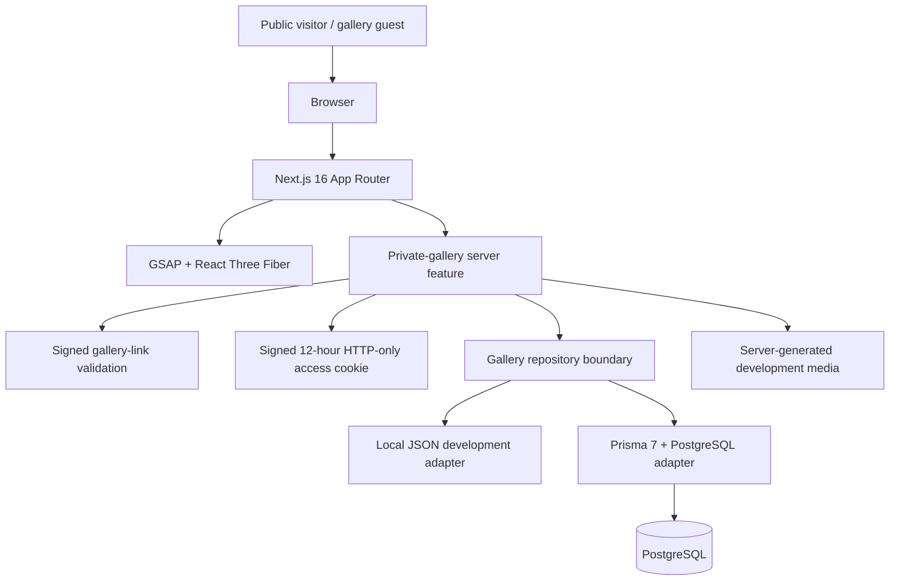
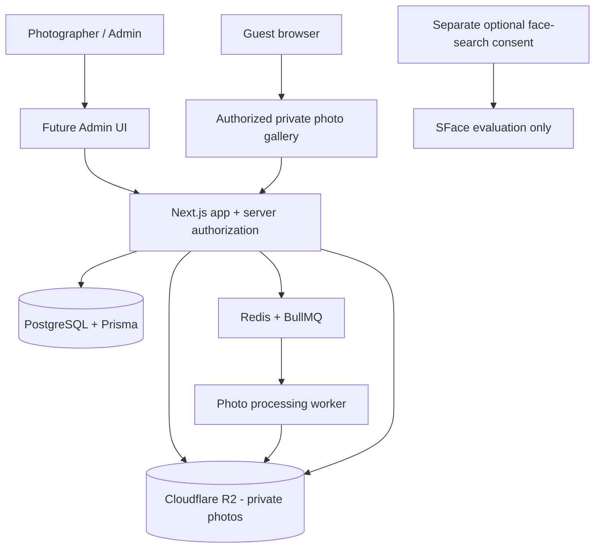

# System Architecture

> Updated 2026-10-26. Eraser remains the primary approved architecture reference under `AGENTS.md`. This file separates verified current code from owner-selected future direction.

## 1. Product boundary
DDS Photographer is a single-photographer business website with a public portfolio, private wedding/event galleries, and a future photographer/admin platform. A photo upload pipeline is planned. Face search is limited to SFace evaluation and requires separate privacy approval. This is not currently a multi-studio SaaS product.

## 2. Current implemented architecture

### Public website
Next.js renders Navbar, Hero, About, Portfolio, Services, Contact, and Footer. GSAP/ScrollTrigger orchestrates scroll motion; a lazy React Three Fiber canvas renders the camera. Static fallback and reduced-motion behavior preserve usability if WebGL/motion is unavailable.

### Private gallery
- `GET /gallery/[token]` validates a signed token on the server.
- Visitors without a valid gallery-scoped cookie see the entry form.
- The form collects name, mobile, email, and current gallery-entry consent.
- The server validates/upserts the visitor and issues a signed 12-hour, HTTP-only, SameSite=Lax cookie scoped to `/gallery`.
- Non-cover media requires a valid gallery-scoped visitor grant.
- The local adapter stores sample data under ignored `.data/private-gallery/` and serves generated placeholders.
- The Prisma adapter persists current gallery records when `DATABASE_URL` is configured.

Current gallery-entry consent is not face-search consent. No face-search processing exists in the current implementation.

## 3. Current code boundaries

| Responsibility | Location |
| --- | --- |
| App routes/pages | `src/app/` |
| Public-site feature | `src/features/public-site/` |
| Motion feature | `src/features/motion/` |
| Private-gallery feature | `src/features/private-gallery/` |
| Generic UI | `src/components/ui/` |
| Shared libraries | `src/lib/` |
| Site configuration | `src/config/` |
| Design tokens | `src/styles/tokens.css` |
| Prisma schema/migrations | `prisma/` |

Secrets, signing, persistence, and authorization stay in server-only modules. Never send signing secrets, storage credentials, or private object keys to client components.

## 4. Selected target direction — not implemented

Selected but not integrated:
- Cloudflare R2 for private photo objects.
- Redis + BullMQ for asynchronous photo processing.
- One shared password per wedding.
- Extendable gallery expiry; exact defaults and retention rules pending.
- SFace evaluation only; production approval pending.
- Cloudflare Stream on hold; current scope is photos only.

## 5. Guest access and face-search consent
Intended future guest flow: open wedding gallery, enter that wedding's shared password, complete gallery-entry requirements, receive a gallery-scoped grant, and view only media authorized for that gallery.

The shared password is not an individual identity and does not replace visitor consent or authorization. Store only a modern password hash; support rate limiting, rotation, and revocation.

Face search is a separate optional feature. Before any selfie, face crop, embedding, or matching operation:
- Show a standalone plain-language notice describing data collected, specific purpose, and use.
- Ask for a separate affirmative opt-in with an unchecked control.
- Do not bundle it with password entry, general gallery entry, or unrelated terms.
- Do not make ordinary gallery access conditional on opting in.
- Record notice/version, purpose, affirmative action, timestamp, and withdrawal state.
- Provide a withdrawal path and approved deletion/retention behavior.

A preselected checkbox is not an affirmative opt-in. A hidden or bundled terms link is not a substitute for a clear notice. This is the project's privacy-by-design requirement; consult the DPDP commencement notes in `10-security.md` before asserting a provision is currently in force.

## 6. Out of current scope
Video (Cloudflare Stream is on hold), production face recognition, admin dashboard/authentication, R2 upload/delivery integration, Redis/BullMQ workers, multi-studio SaaS, mobile app, and payments.

## 7. Change control
Before implementing future components, read the relevant Eraser document and canvas, roadmap, and product specification. If approved Eraser architecture conflicts with this file, stop and ask. Never silently promote a planned component to implemented status.
