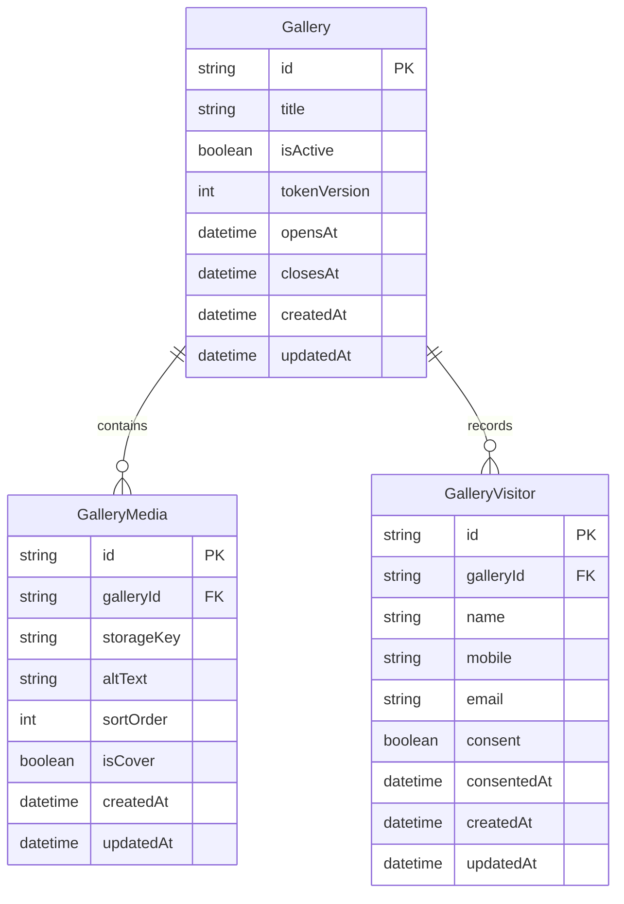

# Database Model and ERD

> Updated 2026-10-26. Implemented models below are taken from `prisma/schema.prisma`. Proposed models are conceptual only and must not be added to Prisma without an approved implementation task.

## 1. Implemented Prisma models
The current schema contains `Gallery`, `GalleryMedia`, and `GalleryVisitor`.

### Gallery
- CUID primary key.
- `isActive` controls availability.
- `tokenVersion` supports revoking previously issued gallery-link tokens.
- `opensAt` and `closesAt` are optional availability boundaries.
- Has many media and visitor records.

### GalleryMedia
- Belongs to one gallery; gallery deletion cascades.
- `storageKey` is an internal storage identifier, not a guest URL.
- `sortOrder` controls ordering; `isCover` identifies the cover.
- Index: `[galleryId, sortOrder]`.

### GalleryVisitor
- Belongs to one gallery; gallery deletion cascades.
- Stores visitor name, mobile, normalized email, and current gallery-entry consent evidence.
- Unique constraint: `[galleryId, email]`; index: `[galleryId]`.
- It is not an authenticated admin or guest account.

The existing `consent` and `consentedAt` fields represent gallery-entry consent only. They must never be reused as permission for selfie capture, face embeddings, face matching, or other face-search processing.

## 2. Proposed future data requirements — not implemented

### Wedding password
A future gallery credential field/entity must store only a modern password hash, never plaintext. It should support rotation, revocation, failed-attempt controls, and audit metadata. Final schema belongs in the admin/security design.

### Extendable expiry
Keep these concepts separate:
- Gallery availability window (`opensAt`, `closesAt`).
- Gallery-link token expiry (currently 30 days).
- Visitor access-cookie expiry (currently 12 hours).
- Gallery retention and permanent deletion.

Extending gallery availability must not silently extend existing signed tokens or visitor cookies unless that behavior is explicitly designed. Issue fresh credentials where required.

### Face-search consent
Design a separate gallery-scoped consent record before face-search data is collected or processed. The model should evidence:
- Visitor and gallery to which the choice applies.
- Specific purpose and personal-data categories in the notice.
- Exact notice text or immutable notice version.
- Explicit affirmative action and timestamp.
- Consent state and withdrawal timestamp.
- Retention/deletion status of derived face-search data.

`GalleryFaceSearchConsent` is a possible conceptual name only, not a current Prisma model. Do not store face-search consent only in `GalleryVisitor.consent`.

Selfies, face crops, embeddings, and match results are future data categories. Their schema, encryption, isolation, access controls, retention, and deletion need a separate approved design. SFace is evaluation-only.

## 3. Future media-processing concepts — not implemented
Upload batches, processing jobs, media variants, and audit events may be needed for R2 and Redis/BullMQ. Design them after the storage and processing workflows are approved. Do not revive the old generic User/Album/Photo/Face/Download ERD as if it described the current database.

## 4. Schema authority
The current schema is `prisma/schema.prisma`; migrations are under `prisma/migrations/`. Update this document when a migration changes schema. Keep implemented models separate from proposed product concepts.
